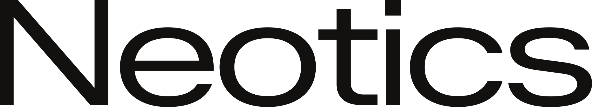

  <a href="https://neotics.io">
    <picture>
      <source media="(prefers-color-scheme: dark)" srcset="neotics-wordmark-white.svg">
      
    </picture>
  </a>

### Neotics ROS 2 · Robot middleware

This is the [Neotics](https://neotics.io) copy of [ROS 2](https://github.com/ros2/ros2). We keep this copy so we can build on it.

The code here comes from the original project. Credit and copyright stay with its authors, under the project's own licence. Neotics is not affiliated with or endorsed by the original project.

This page was added by Neotics. The original project's README is unchanged at [README.md](../README.md), and every change from the original is listed in [NEOTICS.md](../NEOTICS.md).
